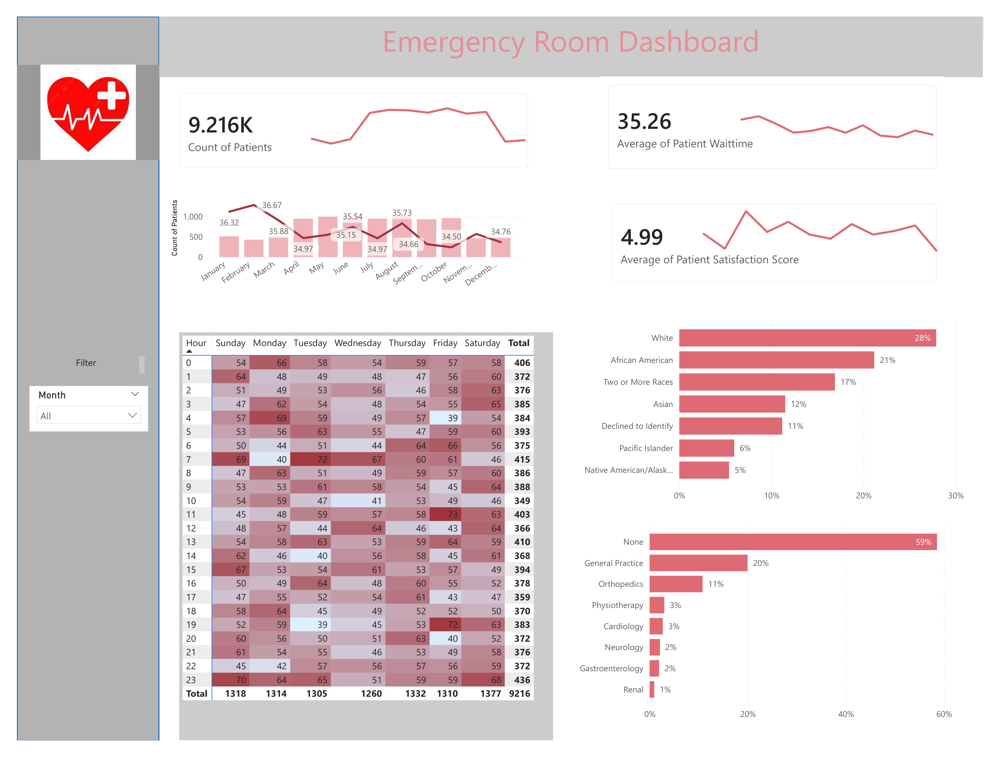

# 🏥 Emergency Room Patient Flow & Operations Dashboard

## 📌 Executive Summary
This Power BI dashboard analyzes operational throughput and patient arrival dynamics across an Emergency Department managing **9,216 patient visits**. It provides hospital executives and clinical administrators with actionable intelligence regarding staffing allocations, bottleneck intervals, and service level adherence.

---

## 🎯 Key Performance Indicators (KPIs)
- **Total Patient Visits:** `9,216`
- **Average Patient Wait Time:** `35.26 minutes`
- **Average Satisfaction Score:** `4.99 / 5.00`
- **Primary Patient Inflow Months:** Peak volumes observed in March, July, and August.

---

## 🔍 Detailed Analysis & Visuals

### 1. 24-Hour Admission Matrix (Day vs. Hour Heatmap)
A dynamic matrix mapping arrivals across 24 hourly buckets (0–23) by day of the week (Sunday through Saturday).
- **Peak Operational Hours:** Patient registrations surge noticeably between **11:00 AM – 3:00 PM** (reaching 60–73 patients/hour) and experience a secondary late-night peak around **11:00 PM (Hour 23)** with 436 patients.
- **Busiest Days:** Saturday (1,377 visits), Thursday (1,332 visits), and Sunday (1,318 visits).

### 2. Department Referrals & Case Distribution
- **Unassigned / General Triage (None):** 59% (5,437 patients)
- **General Practice:** 20% (1,843 patients)
- **Orthopedics:** 11% (1,013 patients)
- **Physiotherapy:** 3%
- **Cardiology:** 3%
- **Neurology:** 2%
- **Gastroenterology:** 2%
- **Renal:** 1%

### 3. Patient Demographics (Diversity Overview)
- **White:** 28%
- **African American:** 21%
- **Two or More Races:** 17%
- **Asian:** 12%
- **Declined to Identify:** 11%
- **Pacific Islander:** 6%
- **Native American / Alaska Native:** 5%

---

## 📁 Files in This Directory
- `Emergency_Room_Dashboard.pdf` — Full vector export of the dashboard report.
- `preview.png` — High-resolution preview image.
- `data/Hospital_ER_Data.csv` — Transactional patient admissions dataset.
