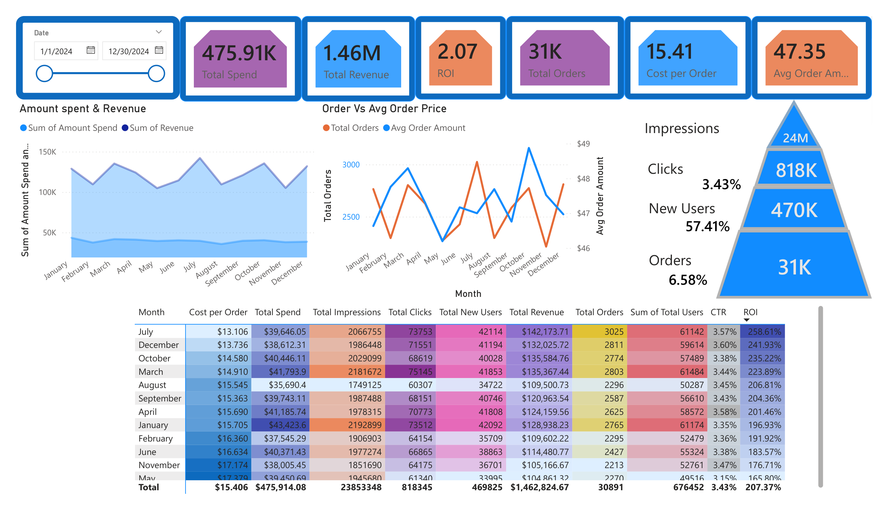

# 🛒 Digital Marketing Performance & E-Commerce ROI Dashboard

## 📌 Executive Summary
This Power BI dashboard provides multi-touch attribution and ROI analysis for an e-commerce enterprise throughout calendar year 2024. Tracking **$475.91K in advertising spend** against **$1.46M in gross sales revenue**, the report analyzes channel efficiency, conversion funnel drops, and customer acquisition costs.

---

## 🎯 Key Performance Indicators (KPIs)
- **Gross Revenue:** `$1,462,824.67 ($1.46M)`
- **Total Advertising Spend:** `$475,914.08 ($475.91K)`
- **Overall Return on Investment (ROI):** `2.07x (207.37%)`
- **Total Orders Fulfilled:** `30,891 (~31K)`
- **Cost per Order (CPO):** `$15.41`
- **Average Order Value (AOV):** `$47.35`
- **Average Click-Through Rate (CTR):** `3.43%`
- **Total Unique Reach:** `676,452 users`

---

## 🔍 Detailed Analysis & Visuals

### 1. 4-Stage Marketing Acquisition Funnel
- **Stage 1 (Impressions):** `23,853,348 (~24M)` total brand exposures.
- **Stage 2 (Clicks):** `818,345 (~818K)` visits with an aggregate CTR of **3.43%**.
- **Stage 3 (New Users):** `469,825 (~470K)` newly acquired users (**57.41%** of clicks).
- **Stage 4 (Orders):** `30,891 (~31K)` successful checkouts (**6.58%** conversion rate from new users).

### 2. Month-over-Month Revenue & ROI Trajectory
- **Top Performing Months:**
  - **July:** Highest monthly revenue ($142,173.71) and highest ROI (**258.61%**) with lowest CPO ($13.11).
  - **December:** Second-highest revenue ($132,025.72) and **241.93%** ROI driven by holiday shopping demand.
  - **October:** $135,584.76 in revenue at **235.22%** ROI.
- **Seasonality & Scaling:** Advertising spend was maintained consistently between $35K – $43K per month, showing that unit economics remained profitable even during high-spend periods.

---

## 📁 Files in This Directory
- `Ecommerce_Marketing_ROI_Dashboard.pdf` — Standalone vector report document.
- `preview.png` — High-resolution preview image.
