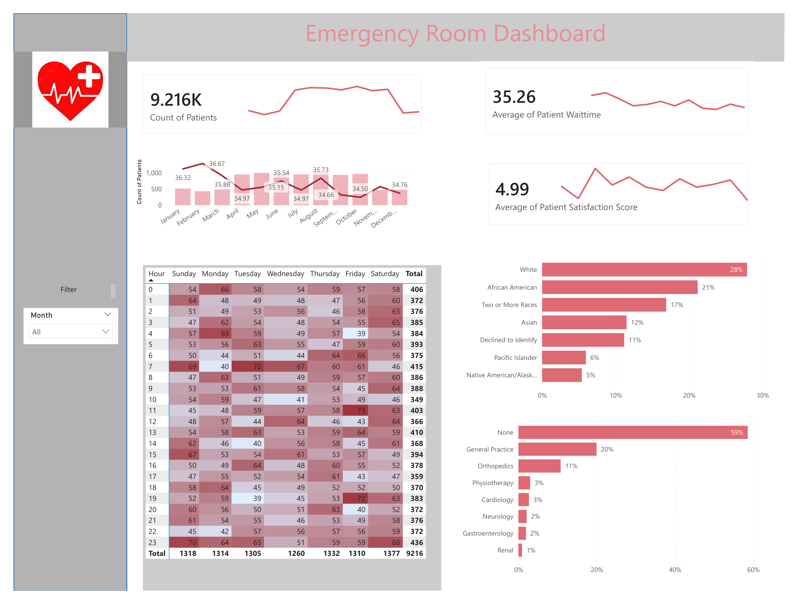
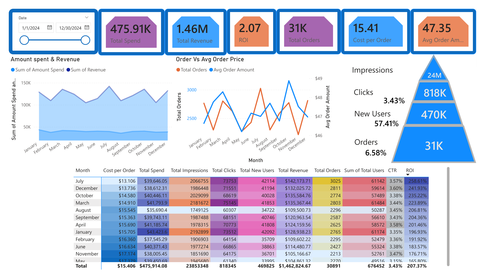

# 📊 Power BI Business Intelligence & Analytics Dashboards

[](https://hadifarrag.github.io/dashboards.html)
[](https://github.com/Hadifarrag)
[](https://www.linkedin.com/in/hady-farrag-6306061b6/)
[](https://powerbi.microsoft.com/)

A centralized, enterprise-standard repository housing production Business Intelligence reports, analytical dashboards, DAX calculation formulas, and data models developed by **Hady Mohamed Farrag**.

Each dashboard translates complex business processes, clinical operations, or transactional marketing data into interactive executive views, KPI scorecards, and actionable decision-making frameworks.

---

## 🗂️ Master Dashboards Catalog

| # | Dashboard Name | Domain / Industry | Core KPIs & Metrics | Key Visualizations | Direct Link |
|---|----------------|-------------------|---------------------|---------------------|-------------|
| **01** | **Emergency Room Patient Flow & Operations** | Healthcare / Clinical | **9,216** Patients<br>**35.26m** Avg Wait<br>**4.99/5** Satisfaction | 24-Hour Admission Matrix, Monthly Wait-Time Sparklines, Demographics, Referral Breakdown | [View Details](01_Emergency_Room_Operations/) |
| **02** | **Digital Marketing Performance & E-Commerce ROI** | E-Commerce / Finance | **$1.46M** Gross Revenue<br>**2.07x (207%)** Total ROI<br>**31K** Orders ($47.35 AOV) | 4-Stage Acquisition Funnel, Spend vs. Revenue Trajectory, Monthly Performance Cohorts | [View Details](02_Ecommerce_Marketing_ROI/) |
| **03+** | *(Future BI Projects)* | *Various* | *Continuous Expansion* | *Tableau, Power BI, Streamlit & Plotly* | *Coming Soon* |

---

## 🏥 01. Emergency Room Patient Flow & Operations



- **Domain:** Hospital Operations, Clinical Throughput, Patient Experience
- **Dataset:** 9,216 Emergency Department Admission Records
- **Core Insights:**
  - **Peak Surge Identification:** Cross-tabulated arrivals by day-of-week and hour (0–23) pinpoint critical staffing deficits between 11:00 AM – 3:00 PM and late-night surges around 11:00 PM.
  - **Wait-Time Variance:** Average wait time maintained at 35.26 minutes, with lower wait times correlating directly to 4.99/5 satisfaction ratings.
  - **Department Demand:** Outpatient referrals led by General Practice (20%), Orthopedics (11%), Physiotherapy (3%), Cardiology (3%), and Neurology (2%).
- **Documentation & Assets:** Full report available in [`01_Emergency_Room_Operations/`](01_Emergency_Room_Operations/) with dataset in `data/Hospital_ER_Data.csv`.

---

## 🛒 02. Digital Marketing Performance & E-Commerce ROI



- **Domain:** Performance Marketing, E-Commerce Analytics, Financial Attribution
- **Dataset Scope:** Full-year 2024 campaign tracking ($475.91K spend across multi-channel funnels)
- **Core Insights:**
  - **Acquisition Funnel Drop-off:**
    $$\text{Impressions (24M)} \xrightarrow{3.43\%\text{ CTR}} \text{Clicks (818K)} \xrightarrow{57.41\%} \text{New Users (470K)} \xrightarrow{6.58\%} \text{Orders (31K)}$$
  - **Unit Economics:** Delivered an Average Order Value (**AOV**) of **$47.35** against a Cost per Order (**CPO**) of **$15.41**, generating a net profit multiplier of **2.07x**.
  - **Seasonality Tracking:** Highest revenue yields achieved in July ($142.17K, 258.6% ROI) and December ($132.02K, 241.9% ROI).
- **Documentation & Assets:** Full report available in [`02_Ecommerce_Marketing_ROI/`](02_Ecommerce_Marketing_ROI/).

---

## 🏗️ Repository Architecture & Future Expansion

This repository is intentionally structured to be the **central repository for all Power BI dashboards** created in the portfolio.

```text
PowerBI_Dashboards/
├── README.md                           # Master catalog and portfolio overview
├── .gitignore                          # Standard gitignore for Power BI & data files
├── templates/
│   └── NEW_DASHBOARD_TEMPLATE.md       # Standard specification template for future additions
├── 01_Emergency_Room_Operations/
│   ├── README.md                       # Comprehensive analytical report
│   ├── preview.png                     # High-res capture (rendered from PDF/PBIX)
│   ├── Emergency_Room_Dashboard.pdf    # Full standalone report document
│   └── data/
│       └── Hospital_ER_Data.csv        # Source transactional dataset
└── 02_Ecommerce_Marketing_ROI/
    ├── README.md                       # Comprehensive analytical report
    ├── preview.png                     # High-res capture
    └── Ecommerce_Marketing_ROI_Dashboard.pdf
```

### Adding a New Dashboard in the Future:
1. Create a numbered directory: `XX_Dashboard_Name/`
2. Include:
   - `preview.png` (high-resolution capture for GitHub and portfolio embeds)
   - `README.md` (business context, metrics, and DAX details using `templates/NEW_DASHBOARD_TEMPLATE.md`)
   - `*.pdf` / `*.pbix` (report artifacts and documentation)
   - `data/` (sample dataset or data dictionary)
3. Update the Master Catalog in this root `README.md`.
4. Deploy the card to the live web portfolio at [hadifarrag.github.io/dashboards.html](https://hadifarrag.github.io/dashboards.html).

---

## 🛠️ Skills & Technologies Demonstrated

- **Business Intelligence:** Power BI Desktop, Data Modeling (Star Schema, Snowflake), Relationship Cardinality
- **Analytics & Formulas:** DAX (Data Analysis Expressions), Time Intelligence, Calculated Columns & Measures
- **Data Engineering:** Power Query (M Language), ETL pipelines, data cleaning, aggregation & normalization
- **Data Visualization:** Heatmaps, Conversion Funnels, Dual-Axis Line/Bar Visuals, Dynamic Slicers & KPI Cards

---

## 👤 Author

**Hady Mohamed Farrag**  
*Data Scientist & AI / BI Developer*  
- 🌐 Portfolio: [hadifarrag.github.io](https://hadifarrag.github.io)
- 📊 Dashboards: [hadifarrag.github.io/dashboards.html](https://hadifarrag.github.io/dashboards.html)
- 💼 LinkedIn: [linkedin.com/in/hady-farrag-6306061b6](https://www.linkedin.com/in/hady-farrag-6306061b6/)
- 🐙 GitHub: [github.com/Hadifarrag](https://github.com/Hadifarrag)
